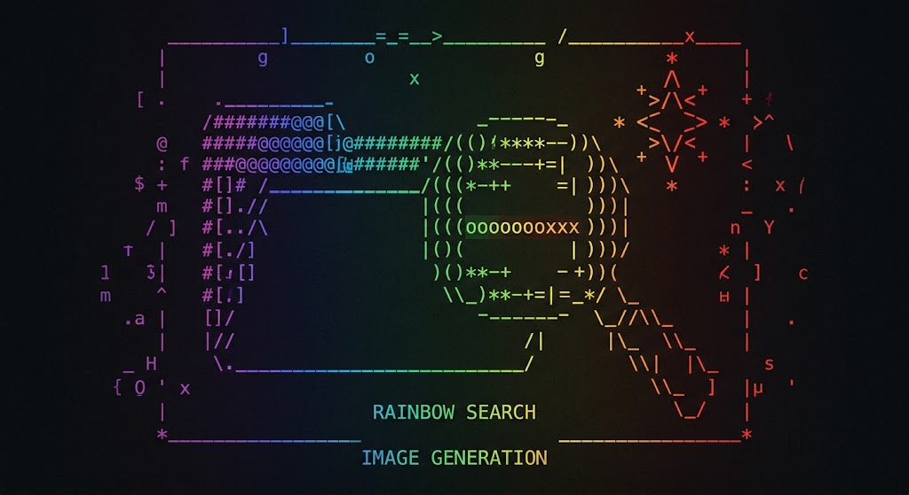
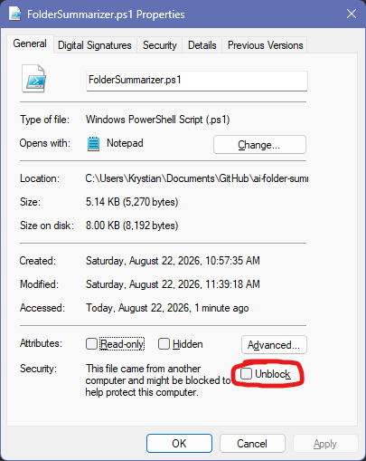

# Folder Summarizer with AI

> **Summarize folder contents instantly with AI**
> *Finally make sense of mystery folders like `erfhfwhuwf` without opening a single file.*



---

## Overview

**Folder Summarizer** adds a convenient **"Summarize with AI"** option to your Windows File Explorer context menu. When run on any directory, it scans the file structure, sends metadata to Google's Gemini AI, and displays a plain-English summary in a dark-themed pop-up window.

Get instant descriptions of folder purposes, dominant file types, and structural patterns without sifting through subdirectories manually.

### Features

* **Config file** (`~/.folder-summarizer/config.yaml`) — all settings in one place
* **Sampling control** — include/exclude categories, set maximum files per group
* **Sensitive file handling** — detect filenames containing passwords, credentials, API keys, and other sensitive patterns
* **Video metadata** — extract duration, resolution, and codec information (requires `ffprobe`)
* **Windows language detection** — automatically detect your system language and request summaries in that language
* **Easy context-menu integration** — right-click any folder or folder background to run the summarizer
* **Execution-policy-friendly launcher** — a small `.cmd` wrapper starts PowerShell with a process-scoped `ExecutionPolicy Bypass`, so the application does not require changing your global PowerShell execution policy

---

## How It Works

1. **Trigger**: Right-click a folder or empty space inside a folder and select **Summarize with AI**.
2. **Launch**: Windows starts `Run-FolderSummarizer.cmd`.
3. **PowerShell launch**: The wrapper starts PowerShell with `-ExecutionPolicy Bypass` for that process only.
4. **Scan**: `FolderSummarizer.ps1` recursively analyzes the directory:

   * Counts total files, subfolders, and cumulative file size.
   * Groups files into categories (*Images, Documents, Video, Audio, Code, Archives*).
   * Samples representative filenames per category.
   * Checks filenames for configured sensitive patterns.
5. **Prompt Generation**: Directory statistics and sampled filenames are assembled into a structured prompt in the detected Windows language.
6. **AI Processing**: The script queries the Google Gemini API.
7. **Display**: A dark-themed summary window displays folder statistics and a concise 3–5 sentence analysis.

The launcher does **not** permanently change the Windows or PowerShell execution policy. `-ExecutionPolicy Bypass` applies only to the PowerShell process started for the summarizer.

---

## Installation

### Prerequisites

* **OS**: Windows 10 or Windows 11
* **Shell**: Windows PowerShell (built-in)
* **Permissions**: Administrator privileges for context-menu registration
* **Network**: Active internet connection
* **API Key**: A valid [Google Gemini API Key](https://aistudio.google.com/apikey)
* **Optional**: `ffmpeg` / `ffprobe` for video metadata

### Required Files

The installer source files are kept together in the `src\` directory:

```text
src/
├── Install.ps1
├── Install-ContextMenu.ps1
├── FolderSummarizer.ps1
└── Run-FolderSummarizer.cmd

assets/
├── logo.jpg
└── unblock.jpg

build/
└── FolderSummarizer.exe
```

### Quick Setup

1. Download or clone the repository.

2. Open PowerShell in the repository directory.

3. Run:

   ```powershell
   .\src\Install.ps1
   ```

   This creates the configuration directory:

   ```text
   %USERPROFILE%\.folder-summarizer\
   ```

   and creates a default:

   ```text
   config.yaml
   ```

4. Edit the configuration:

   ```powershell
   notepad ~\.folder-summarizer\config.yaml
   ```

   Set:

   ```yaml
   api_key: "YOUR_KEY_HERE"
   ```

   to your Google Gemini API key.

5. Register the File Explorer context menu:

   ```powershell
   .\src\Install.ps1 -RegisterContextMenu
   ```

   **Run this step as Administrator.**

6. Right-click a folder or empty space inside a folder and select:

   **Summarize with AI**

---

## Direct Usage

You can run the PowerShell script directly:

```powershell
.\src\FolderSummarizer.ps1 -FolderPath "C:\MyFolder"
```

You can also use the launcher:

```cmd
.\src\Run-FolderSummarizer.cmd "C:\MyFolder"
```

The launcher is useful on systems where PowerShell execution policies would otherwise prevent the script from running.

You can specify a custom configuration file:

```powershell
.\src\FolderSummarizer.ps1 `
    -FolderPath "C:\MyFolder" `
    -ConfigPath "C:\my-config.yaml"
```

---

## Configuration (`config.yaml`)

All configuration is stored in:

```text
%USERPROFILE%\.folder-summarizer\config.yaml
```

Example:

```yaml
api_key: "YOUR_KEY_HERE"
model: "gemini-3.7-flash"

sampling:
  max_files_per_group: 5

  groups:
    include: ["Images", "Documents", "Code", "Audio", "Video", "Archives"]
    exclude: []

  extensions:
    whitelist: []
    blacklist: [".exe", ".dll", ".pyc", ".class"]

video:
  sample_frames: 5
  sample_only_metadata: true

security:
  sensitive_patterns:
    - "credential"
    - "password"
    - "secret"
    - "token"
    - "recovery"
    - "key"
    - "\\.pem$"
    - "\\.key$"

  content_regex:
    - "BEGIN (RSA|OPENSSH|DSA) PRIVATE KEY"
    - "sk-[a-zA-Z0-9]{20,}"
    - "gh[pousr]_[a-zA-Z0-9]{36}"

  action: "mask"

ui:
  detect_windows_language: true
  override_language: ""
```

### Configuration Options

#### `api_key`

Your Google Gemini API key.

```yaml
api_key: "YOUR_KEY_HERE"
```

#### `model`

The Gemini model used for summarization.

```yaml
model: "gemini-3.7-flash"
```

#### `sampling.max_files_per_group`

Maximum number of representative filenames included from each category.

```yaml
sampling:
  max_files_per_group: 5
```

#### `sampling.groups`

Controls which file categories are included or excluded.

```yaml
groups:
  include: ["Images", "Documents", "Code", "Audio", "Video", "Archives"]
  exclude: []
```

For example:

```yaml
exclude: ["Archives", "Video"]
```

#### `sampling.extensions`

Optional extension whitelist and blacklist.

```yaml
extensions:
  whitelist: []
  blacklist: [".exe", ".dll", ".pyc", ".class"]
```

An empty whitelist means all supported extensions are allowed.

#### `video`

Controls video metadata extraction.

```yaml
video:
  sample_frames: 5
  sample_only_metadata: true
```

When `sample_only_metadata` is `true`, only metadata such as duration, resolution, and codec is collected.

#### `security`

Controls sensitive filename and content-pattern detection.

```yaml
security:
  sensitive_patterns:
    - "password"
    - "secret"

  content_regex:
    - "BEGIN (RSA|OPENSSH|DSA) PRIVATE KEY"

  action: "mask"
```

The current implementation primarily uses these settings to identify sensitive data during scanning. Review your configuration carefully before using the tool on folders containing confidential information.

#### `ui`

Controls language detection.

```yaml
ui:
  detect_windows_language: true
  override_language: ""
```

To force a specific language:

```yaml
override_language: "pl-PL"
```

---

## Usage

1. Open **File Explorer**.
2. Navigate to the directory you want to inspect.
3. Right-click the folder or empty space inside the folder.
4. Select **Summarize with AI**.
5. Wait for the scan and API request to complete.
6. A dark-themed window will display:

   * Directory path
   * File count
   * Folder count
   * Total size
   * Category breakdown
   * Sampled filenames
   * AI-generated summary
7. Click **Close** when finished.

If the window does not immediately appear, check the PowerShell icon on your Windows taskbar.

---

## Example Output

```text
  ==============================================================
    FOLDER SUMMARY  -  MyProject
  ==============================================================

  Path    : C:\Users\me\Documents\MyProject
  Files   : 142   |   Folders: 23   |   Size: 456.78 MB
  Model   : gemini-3.7-flash
  Language: en-US

  --------------------------------------------------------------
  FILES CHECKED (first 5 per type):
  --------------------------------------------------------------

    Images       [  12] : logo.png, screenshot1.jpg, icon.ico, banner.webp, bg.png
    Documents    [  34] : readme.md, specification.docx, budget.xlsx, notes.txt, plan.pdf
    Code         [  76] : main.py, utils.js, style.css, index.html, app.cs
    ...

  --------------------------------------------------------------
  AI SUMMARY:
  --------------------------------------------------------------

    This folder appears to be a software project for a web application.
    The majority of files consist of source code (Python, JavaScript, HTML)
    alongside relevant technical documentation. UI assets such as images
    and icons are also included. The structure is well-organized.
```

---

## Privacy & Security

Folder Summarizer does **not** upload the actual contents of scanned files to Gemini.

However, information derived from the folder structure may be included in the API request, including:

* File names
* Folder names
* Full paths
* File extensions
* File sizes
* File counts
* Folder counts
* Modification-related metadata used by the application
* Sampled filenames used to build the AI prompt

This means filenames themselves can contain sensitive information.

For example:

```text
password.txt
company-secret-project/
backup_recovery_key.zip
john.doe_private_documents/
```

could reveal information even when the actual file contents are never uploaded.

The application displays a privacy/security warning before scanning.

Review scanned folders and generated output before sharing them publicly.

---

## Execution Policy

The context-menu integration does not require permanently changing PowerShell's execution policy.

The registry entry launches the installed launcher:

```text
Run-FolderSummarizer.cmd
```

which then launches PowerShell using:

```text
-ExecutionPolicy Bypass
```

This applies only to the PowerShell process started by the launcher.

It does **not** permanently execute:

```powershell
Set-ExecutionPolicy Bypass
```

and does not intentionally modify the user's global PowerShell execution-policy settings.

---

## Uninstallation

### Remove the Context Menu

Run the following commands from an elevated PowerShell window:

```powershell
Remove-Item `
    -Path "HKLM:\SOFTWARE\Classes\Directory\shell\FolderSummary" `
    -Recurse `
    -Force

Remove-Item `
    -Path "HKLM:\SOFTWARE\Classes\Directory\Background\shell\FolderSummary" `
    -Recurse `
    -Force
```

### Remove Installed Files

Delete:

```text
C:\Scripts\FolderSummarizer.ps1
C:\Scripts\Run-FolderSummarizer.cmd
```

### Remove Configuration

If you no longer need your configuration and API key, delete:

```text
%USERPROFILE%\.folder-summarizer\
```

---

## Troubleshooting

| Problem                                    | Cause                                                                  | Solution                                                                                                |
| ------------------------------------------ | ---------------------------------------------------------------------- | ------------------------------------------------------------------------------------------------------- |
| **Context menu item missing**              | Context-menu registration did not complete                             | Run `.\src\Install.ps1 -RegisterContextMenu` as Administrator and make sure all required files are present. |
| **Execution policy block error**           | The PowerShell script was launched directly under a restrictive policy | Run `Run-FolderSummarizer.cmd` instead. The launcher uses a process-scoped `-ExecutionPolicy Bypass`.   |
| **"API Error" appears**                    | Invalid API key, network problem, or API error                         | Verify the Gemini API key in `config.yaml` and check your internet connection.                          |
| **Pop-up window is not visible**           | The window was opened behind another application                       | Check the PowerShell application on the Windows taskbar.                                                |
| **No summary is generated**                | Empty folder, API failure, or rate limit                               | Make sure the folder contains files and verify your API key and network connection.                     |
| **Sensitive filename was not detected**    | Pattern is missing or does not match the filename                      | Add or adjust the appropriate pattern in `security.sensitive_patterns`.                                 |
| **Video metadata is missing**              | `ffprobe` is unavailable                                               | Install [ffmpeg](https://ffmpeg.org/download.html) and make sure `ffprobe` is available in `PATH`.      |
| **Context menu works but nothing happens** | Launcher or installed script is missing                                | Verify that `C:\Scripts\Run-FolderSummarizer.cmd` and `C:\Scripts\FolderSummarizer.ps1` both exist.     |



---

## Technical Notes

* **Dependencies**: Native PowerShell and built-in .NET assemblies. No third-party PowerShell modules are required.
* **Optional dependency**: `ffmpeg` / `ffprobe` for video metadata extraction.
* **Configuration parser**: A built-in minimal YAML parser handles nested dictionaries, arrays, quoted strings, and comments.
* **AI model**: The default configuration uses `gemini-3.7-flash`.
* **Language**: Windows language detection can automatically determine the requested output language.
* **Context menu**: The installer registers entries for both right-clicking a folder and right-clicking empty space inside a folder.
* **Launcher**: `Run-FolderSummarizer.cmd` starts the PowerShell application with a process-scoped `ExecutionPolicy Bypass`.
* **PowerShell policy**: The application does not require permanently changing the system or user execution policy.
* **Privacy**: The application sends folder and file metadata used to generate the AI prompt to Google Gemini, but does not upload the actual contents of scanned files.
* **Security warning**: Because filenames and folder names can contain sensitive information, the application asks the user to acknowledge the privacy implications before scanning.

---

## License

Free to use, modify, and distribute as-is.


